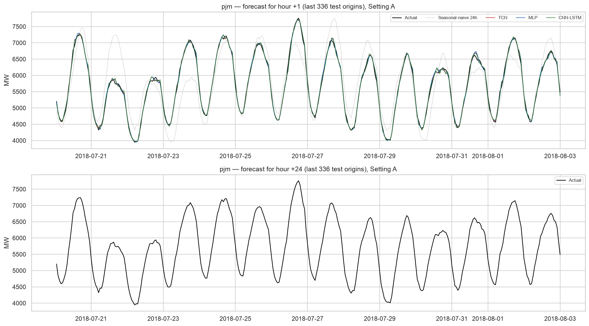
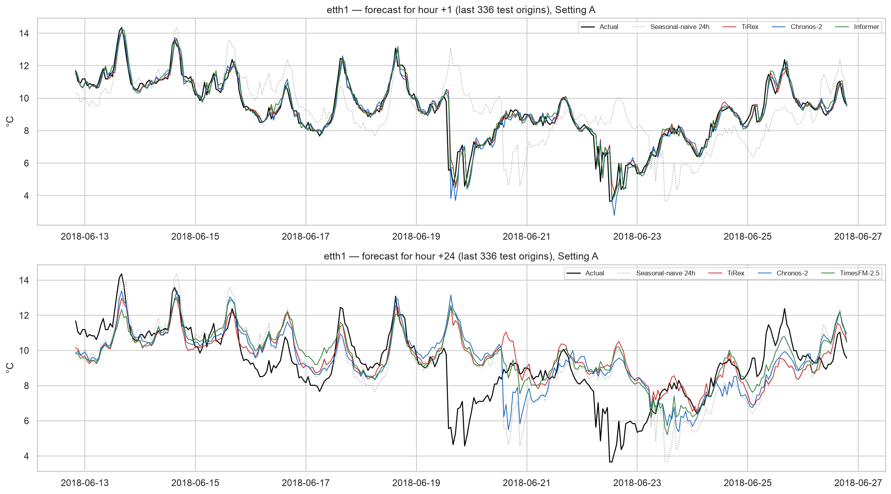
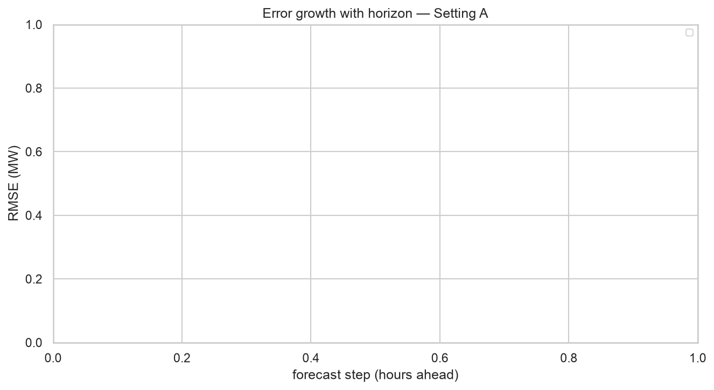
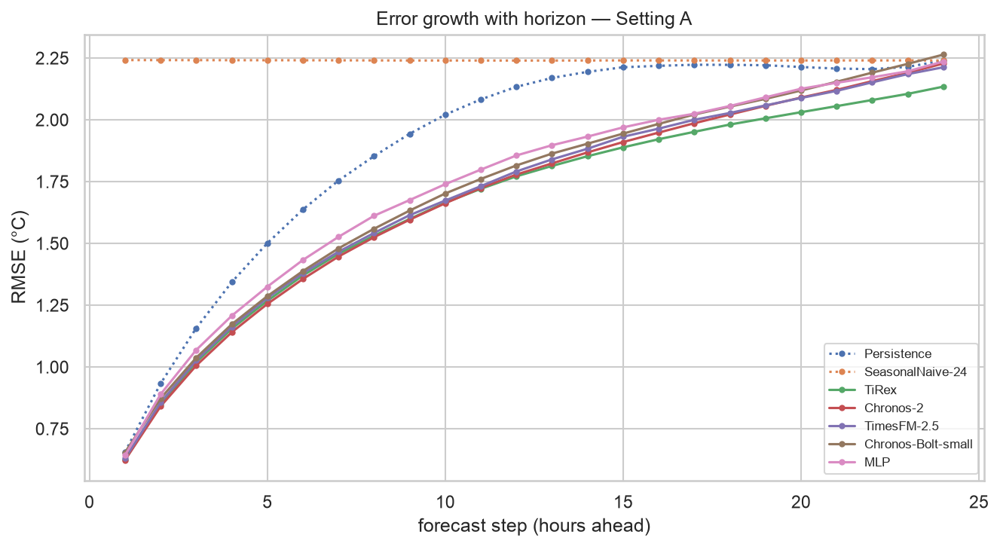

# AIFS: Benchmarking Deep Learning and Foundation Models for Short-Term Energy Forecasting

**Toward Sustainable Grid Operation**


Code, results and paper for a **single-protocol benchmark of up to 33 forecasting models from six families** on two public hourly datasets: the regional load of **PJM West** (143,232 h) and the oil temperature of the **ETTh1** transformer (17,420 h). Every model uses the same chronological 70/10/20 split and the same tuning budget, and is scored at **1-hour** and **24-hour** horizons with RMSE, MAE, NRMSE, MASE and Diebold-Mariano significance tests.

> Authors: Aksh Ashvinbhai Dharodiya, Harshil Andhariya, Suhani Achariya, Nitesh A. Funde
> Department of Artificial Intelligence, Sardar Vallabhbhai National Institute of Technology (SVNIT), Surat, India

---

## Table of Contents

- [Highlights](#highlights)
- [Headline Results](#headline-results)
- [Model Zoo](#model-zoo)
- [Experimental Protocol](#experimental-protocol)
- [Repository Structure](#repository-structure)
- [Getting Started](#getting-started)
- [Running the Benchmark](#running-the-benchmark)
- [Outputs and Reproducing the Paper](#outputs-and-reproducing-the-paper)
- [Selection of the Five Models](#selection-of-the-five-models)
- [Limitations](#limitations)
- [Citation](#citation)
- [Acknowledgements](#acknowledgements)

---

## Highlights

- **Fair comparison.** Same data pipeline, split, input channels, tuning budget and metrics for all models. Foundation models are used zero-shot.
- **Strong references included.** Persistence and seasonal-naive (24 h / 168 h) forecasts are reported in every table, because on smooth hourly series they can be hard to beat.
- **Leakage-safe.** Scalers and clipping bounds are fit on the training period only, imputation is causal (forward fill), and metrics are computed only on hours where the target was actually observed.
- **Two datasets of different character.** A large, strongly seasonal grid aggregate (PJM West) and a short, noisy single-asset series (ETTh1).
- **Statistical testing.** Diebold-Mariano tests with a Newey-West variance estimate.
- **Operational and sustainability view.** Each horizon is mapped to an operating decision, and the compute footprint of each model class is discussed.

---

## Headline Results

Five models are selected by a fixed rule from the 1-hour results of both datasets: **N-BEATS, TCN, N-HiTS, iTransformer and GRU**.

**NRMSE (%) of the five selected models** (lower is better; test sets):

| Model | PJM West 1 h | PJM West 24 h | ETTh1 1 h | ETTh1 24 h |
|---|---:|---:|---:|---:|
| N-BEATS | 0.99 | **5.33** | 8.20 | 24.98 |
| TCN | 1.02 | 5.48 | **8.17** | 25.70 |
| N-HiTS | 0.99 | 5.36 | 8.32 | 24.61 |
| iTransformer | 1.02 | 5.40 | 8.20 | **23.46** |
| GRU | **0.98** | 5.34 | 8.40 | 24.04 |
| *Persistence* | 3.86 | 17.31 | 8.47 | 25.27 |
| *Seasonal-naive-24* | 8.84 | 8.84 | 28.97 | 29.02 |
| *Best zero-shot foundation model (TiRex)* | 1.15 | 6.04 | 8.06 | 22.16 |
| *Best ensemble* | 0.97 | 5.24 | 7.94 | 21.89 |

Bold marks the best of the five selected models in each column.

**Key findings**

- On **PJM West**, the five networks reduce 1-hour RMSE by about **74%** and day-ahead RMSE by about **69%** relative to persistence, and day-ahead RMSE by 38-40% relative to seasonal-naive-24. The five are within 0.1 percentage points of each other, so differences among them are practical ties.
- On **ETTh1**, margins over persistence at 1 h are small (0.8-3.6%), and the **zero-shot foundation model TiRex is the best single model at both horizons**. At 24 h, TCN does not beat persistence.
- The best model depends on the dataset, mainly on the amount of local training data. This argues for evaluating several families before deployment.
- **Ensembles of validation-selected models add a further 1-2%**, but multiply the compute cost.
- **Compact networks come within a few percent of the best accuracy**, which makes them a sensible default when the computing footprint of forecasting matters.

### Forecast examples

| PJM West, 24-step forecast vs actual | ETTh1, 24-step forecast vs actual |
|---|---|
|  |  |

| PJM West, error growth with horizon | ETTh1, error growth with horizon |
|---|---|
|  |  |

### From horizon to operational decision

| Horizon | Decision supported | How a better forecast conserves energy |
|---|---|---|
| 1 h (real-time) | Dispatch of flexible units, regulation and spinning reserve, demand-response triggers | Smaller reserve margins, fewer fast-start units in standby |
| 24 h (day-ahead) | Unit commitment, generation scheduling, day-ahead power purchase | Fewer unnecessary start-ups and less over-commitment of fossil units |
| 1 h and 24 h (asset) | Loading limits and cooling control of a transformer from predicted oil temperature | Cooling runs only when needed, overheating and premature ageing are avoided |

Energy savings are described qualitatively. The paper does not estimate them in MWh or emissions.

---

## Model Zoo

Up to 33 individual models from six families, plus two ensembles.

| Family | Models |
|---|---|
| **Baselines** | Persistence, Seasonal-naive (24 h, 168 h), Ridge regression, Prophet, Prophet anchored to the last observation |
| **Tree-based** | Random Forest, ExtraTrees, XGBoost, LightGBM, CatBoost (PJM only) |
| **Deep learning** | MLP, LSTM, GRU, BiLSTM, CNN-LSTM, TCN, N-BEATS, N-HiTS |
| **Transformer and related** | Transformer, PatchTST, iTransformer, DLinear, TSMixer, Informer, Autoformer\*, TimesNet\*, TFT\* |
| **Foundation (zero-shot)** | Chronos-Bolt small and base, Chronos-2, TimesFM 2.5, TiRex |
| **Generative** | Conditional VAE (CVAE\*) |
| **Ensembles** | Equal-weight mean of the top 3, inverse-validation-MSE weighted top 5 (members and weights chosen on validation only) |

\* ETTh1 only.

> The PatchTST, iTransformer, Informer, Autoformer, TimesNet and TFT implementations are **compact re-implementations in the spirit of the original papers**, not the authors' reference code. They are suitable for a fair relative comparison under one protocol, not for reproducing published absolute numbers.

---

## Experimental Protocol

| Item | PJM West | ETTh1 |
|---|---|---|
| Target | Load (MW) | Oil temperature (°C) |
| Period | 2002-04 to 2018-08 | 2016-07 to 2018-06 |
| Hourly samples | 143,232 | 17,420 |
| Train / val / test | 100,262 / 14,323 / 28,647 | 12,194 / 1,742 / 3,484 |
| Covariates | none | 6 load variables (HUFL, HULL, MUFL, MULL, LUFL, LULL) |
| Calendar channels | 8 (incl. US holidays) | 7 |

**Forecasting task.** At each forecast origin `t`, a model receives the last `L` hours of the target, the covariates observed up to `t`, and calendar features, and predicts `H` ∈ {1, 24} hours ahead. For `H = 24`, networks predict all 24 steps jointly (direct multi-output), and tree models fit one model per step.

**Preprocessing.**

- Chronological split: 70% train, 10% validation, 20% test.
- Causal imputation (forward fill, leading gaps filled with the training median). Loss and metrics only at observed hours.
- Covariates clipped at the 0.5% and 99.5% training quantiles. Target and covariates standardised with training statistics.
- Calendar features: sine/cosine of hour of day, day of week and day of year, a weekend flag, and a US public-holiday flag (PJM West only).
- Neural models predict the **deviation from the last observed value** (a persistence skip connection), so persistence is the natural reference.

**Training and tuning.**

- Optimiser: AdamW with cosine-annealed learning rate, gradient-norm clipping at 1.0, up to 30 epochs, early stopping (patience 5).
- Hyperparameters tuned with Optuna's TPE sampler on the validation set. Trials per model: 8 for recurrent, convolutional, residual-stack and linear models, 6 for Transformer-type and mixer models, 10 for gradient boosting. 25-minute cap per model, median pruner, first trial is a fixed default.
- The best configuration is fitted on train, then refitted on train + validation before predicting the test set.
- Foundation models are not trained. Only the context length is chosen from {168, 512} on validation.
- Each model is run once with a fixed seed (`SEED = 42`).

**Metrics.**

```
RMSE  = sqrt( mean(e^2) )          MAE   = mean(|e|)
NRMSE = 100 * RMSE / mean(y_test)  MASE  = MAE / mean |y_t - y_(t-24)| on training targets
```

Significance is assessed with the Diebold-Mariano test on the squared-error loss differential, using a Newey-West variance estimate.

---

## Repository Structure

```
.
├── final_pjm_notebook_kaggel.ipynb     # PJM West benchmark, dual-GPU Kaggle version (T4 x2)
├── 3aifs_v10_etth1.ipynb               # ETTh1 benchmark, local/Kaggle single-process version
├── main.pdf                            # The paper
├── aifs_results_STANDARD_pjm/          # Final results used in the paper (STANDARD run mode)
│   ├── results.csv                     # All metrics for every dataset / model / horizon
│   ├── leaderboard_*.csv               # Leaderboards per dataset and horizon
│   ├── best_models_{pjm,etth1}.json    # Best single model and its hyperparameters
│   ├── leakage_ablation_etth1.csv      # Setting A (true forecasting) vs B (leaky covariates)
│   ├── figs/                           # EDA, forecast-vs-actual, error by step / hour, cost plots
│   ├── paper_tables/                   # Paper tables as CSV + Markdown + LaTeX, plus auto-written summaries
│   ├── cross_dataset/                  # Cross-dataset ranks, heat-maps, relative RMSE, ensemble gain
│   ├── tuning/                         # Best params (.json) and Optuna trial histories (_trials.csv)
│   ├── preds/                          # Saved test predictions (.npz) per model
│   ├── artifacts/                      # Feature-importance tables for tree models
│   └── state/                          # Crash-recovery and device-choice state
├── kaggle_output_pjm_dataset/          # Raw Kaggle output of the PJM run
└── kaggle_output.zip                   # Packaged Kaggle outputs
```

File names inside `results`, `tuning` and `preds` follow the pattern `<dataset>_<setting>_H<horizon>_<model>`, for example `pjm_A_H1_GRU.npz`. **Setting A** is the headline true-forecasting setup (only information available at the forecast origin). **Setting B** is the older concurrent-covariate setup, kept only as a labelled reference for the leakage ablation.

---

## Getting Started

### 1. Clone

```bash
git clone https://github.com/harshil-2507/AIFS-research.git
cd AIFS-research
```

### 2. Install dependencies

Python 3.10+ is recommended.

```bash
pip install torch numpy pandas scikit-learn matplotlib seaborn pyarrow
pip install optuna xgboost lightgbm catboost prophet holidays

# Foundation models (optional, a model whose install fails is simply skipped)
pip install chronos-forecasting      # Chronos-Bolt and Chronos-2
pip install tirex-ts                 # TiRex
pip install "timesfm[torch]"         # TimesFM 2.5
```

Foundation-model weights are downloaded from Hugging Face on first use, so internet access is required for those models.

**Apple Silicon note.** PyTorch uses the Apple GPU (`mps`) when available. XGBoost and LightGBM need an arm64 OpenMP runtime: `arch -arm64 brew reinstall libomp`. Do not `pip install libomp`.

### 3. Download the datasets

| Dataset | Source | File used |
|---|---|---|
| PJM West hourly load | [Kaggle: Hourly Energy Consumption](https://www.kaggle.com/datasets/robikscube/hourly-energy-consumption) | `PJMW_hourly.csv` |
| ETTh1 | [ETDataset (ETT-small)](https://github.com/zhouhaoyi/ETDataset) | `ETTh1.csv` |

Datasets are not included in this repository.

---

## Running the Benchmark

### Option A: PJM West on Kaggle (dual GPU, recommended)

Notebook: `final_pjm_notebook_kaggel.ipynb`

1. Upload the notebook to Kaggle. Set **Accelerator → GPU T4 x2** and **Internet → On**.
2. Add the PJM dataset as an input and set `PJM_FILE` in the settings cell (`KCFG`) to the path of `PJMW_hourly.csv`.
3. Use **Save Version → Save & Run All (Commit)**. The run continues in the background.

The notebook splits models across two worker processes (one per GPU), merges their outputs, then builds ensembles, leaderboards, Diebold-Mariano tests and paper tables. It is **resumable**: finished models are skipped, and it stops cleanly at `DEADLINE_HOURS` (default 10.5 h) to respect Kaggle's 12-hour session limit. If a run is interrupted, add the previous output as an input dataset and run again. Crashed workers are restarted automatically (`MAX_RESTARTS`).

### Option B: ETTh1 (or any dataset) locally

Notebook: `3aifs_v10_etth1.ipynb`

1. **Run Cell 0 first** after every kernel restart. It sets an OpenMP guard that prevents PyTorch and XGBoost/LightGBM from crashing the kernel on macOS.
2. Run the install cell once, then restart the kernel.
3. In the CONFIG cell, edit `CFG['DATA_PATHS']` so it points to your local copy of `ETTh1.csv` (the file currently contains the authors' local paths).
4. Run all cells. Results are saved to `aifs_results_<RUN_MODE>/` and finished models are never recomputed.

### Configuration

All settings live in one config cell:

```python
CFG = dict(
    RUN_MODE = 'STANDARD',   # 'SMOKE' | 'LITE' | 'STANDARD' | 'FULL'
    DATASET  = 'etth1',      # 'etth1' | 'pjm' (also 'ihepc', 'spain' loaders exist)
    SETTINGS = ['A'],        # 'A' = true forecasting (headline), 'B' = leaky reference
    HORIZONS = [1, 24],
    MODELS   = None,         # None = all, or e.g. ['XGBoost', 'GRU', 'TiRex']
    EXCLUDE  = [],           # e.g. ['TimesNet', 'TFT'] to skip the slowest models
    RUN_FOUNDATION = True,
    SEED = 42,
)
```

| Run mode | Purpose | Data | Tuning budget |
|---|---|---|---|
| `SMOKE` | Verify the pipeline in minutes | 2,500 h | 2 trials, 3 epochs |
| `LITE` | Laptop run, roughly 1-3 h | 12,000 h | 3-4 trials, 15 epochs |
| `STANDARD` | **Used in the paper** | All data | 6-10 trials, 30 epochs |
| `FULL` | Extended study | All data | 20-40 trials, 60 epochs, 3 seeds, 3-fold rolling-origin CV |

Quick checks and shortcuts:

- Re-run only one model: `RUN_MODE='SMOKE'`, `MODELS=['TiRex']`.
- One-line presets such as `PRESET = 'etth1_fast'` or `'pjm_fast'` apply recommended settings. Restart the kernel between datasets.
- To run on CPU only: `CFG['NN_DEVICE'] = 'cpu'`.

### Adding a new dataset

Add a loader next to the existing ones in the dataset cell. It must return `dict(df=<hourly DataFrame with column 'y' and covariates>, covariates=[...], holiday_country=...)`, then add its path to `CFG['DATA_PATHS']` and set `CFG['DATASET']`.

---

## Outputs and Reproducing the Paper

After a run, the cells below produce everything reported in the paper.

| Paper element | Where it comes from |
|---|---|
| Tables VIII, IX, X (results) | `paper_tables/*_H1_full.*`, `*_H24_full.*`, `leaderboard_*.csv` |
| Table VII (cross-dataset ranking) | `cross_dataset/average_rank.csv`, `cross_dataset_rank_H1.tex` |
| Table VI (selected configs, parameters, train time) | `tuning/*.json`, `results.csv` |
| Figs. 3-4 (forecast vs actual) | `figs/{pjm,etth1}_actual_vs_pred.png` |
| Figs. 5-6 (error vs forecast step) | `figs/{pjm,etth1}_rmse_by_step.png` |
| Figs. 7-8 (error by hour of day) | `figs/{pjm,etth1}_rmse_by_hour.png` |
| Fig. 2 (best of each family) | `cross_dataset/relative_rmse.png`, `family_summary.csv` |
| Diebold-Mariano markers | `paper_tables/*_full.*` (`best` / `n.s.` / `sig. worse`) |
| Ensemble gains | `cross_dataset/ensemble_gain.csv` |
| Accuracy vs cost | `figs/{pjm,etth1}_accuracy_vs_cost.png` |
| Leakage ablation | `leakage_ablation_etth1.csv` |

LaTeX tables use `booktabs`, so add `\usepackage{booktabs}` to your preamble. Each dataset also gets an auto-written summary paragraph in `paper_tables/paper_summary_<dataset>.txt`.

---

## Selection of the Five Models

The five models studied in depth are chosen by a fixed, transparent rule applied to the **1-hour** results:

1. Take the 19 individual non-baseline models evaluated on both datasets.
2. Rank each by test RMSE on each dataset, then average the two ranks.
3. Keep the five lowest mean ranks. Ties are broken by mean RMSE relative to the best model of each dataset.

| # | Model | PJM rank | ETTh1 rank | Mean rank |
|---|---|---:|---:|---:|
| 1 | N-BEATS | 2 | 4 | 3.00 |
| 2 | TCN | 5 | 3 | 4.00 |
| 3 | N-HiTS | 3 | 8 | 5.50 |
| 4 | iTransformer | 6 | 5.5 | 5.75 |
| 5 | GRU | 1 | 11 | 6.00 |
| 6 | TiRex | 11 | 1 | 6.00 |

Ensembles are shown as a reference and are not among the five.

---

## Limitations

- Two datasets, one chronological split per dataset, and **one run per model** (no confidence intervals over seeds or splits beyond the Diebold-Mariano tests).
- Diebold-Mariano tests compare the best model against its four closest competitors, not every pair of the five selected models.
- Comparison with published results (Informer on ETTh1, MAPE studies on PJM) is **indicative only**, because regions, periods and protocols differ.
- ETTh1 test window (Feb-Jun 2018) is colder than its training data, which lowers absolute errors for every model, including persistence.
- Training times were recorded on different machines for the two datasets and should be read as indicative.
- The energy consumed by the models themselves was not measured. A direct measurement of energy per forecast is future work.

**Future work:** more datasets (other regions, building-level and renewable series), repeated runs and rolling-origin evaluation, probabilistic forecasts with calibrated intervals, energy-per-forecast measurement, and a same-protocol re-evaluation of published ETTh1 models on this test window.


---

## Acknowledgements

The authors thank the Department of Artificial Intelligence, Sardar Vallabhbhai National Institute of Technology, Surat, for support, and the providers of the public datasets used in this work (PJM Interconnection regional load via Kaggle, and the ETT dataset by Zhou et al.).

## Contact

- Nitesh A. Funde: nitesh.funde@aid.svnit.ac.in
- Aksh Ashvinbhai Dharodiya: u23ai031@coed.svnit.ac.in
- Harshil Andhariya: u23ai021@coed.svnit.ac.in
- Suhani Acharya: u23ai037@coed.svnit.ac.in

